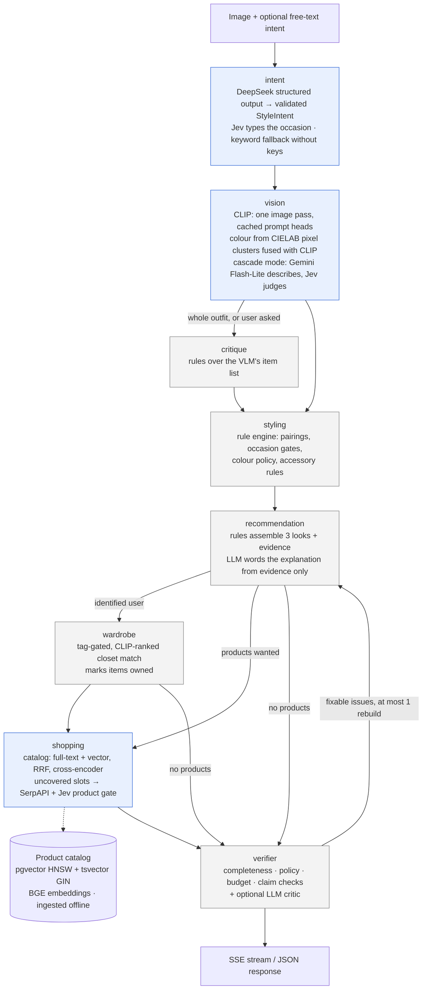

# Synclook AI

A multimodal fashion-recommendation workflow: upload a garment photo, optionally say what you need
in plain language ("style this for a rainy dinner under ₹5,000"), and get complete, verified
outfit recommendations with real product links — preferring clothes you already own.

Built as a production-shaped showcase of applied Gen AI engineering: **a LangGraph workflow whose
steps are model-powered where perception and language need a model, and deterministic where
correctness needs a rule** — structured LLM outputs validated by a rule engine, a perception
cascade with measured accuracy and cost, retrieval with a reranker, eval-gated CI, and
LLM-as-judge quality measurement.

## Architecture



Blue nodes make a model-based judgement; grey nodes are deterministic code (recommendation and
the verifier call an LLM only to word or second-guess what the rules already decided).

The graph is compiled LangGraph (`backend/graph/graph.py`); the `Orchestrator` is a thin façade
that preserves the original REST/SSE contract. Vision failures are fatal, everything downstream
returns partial results, and the intent/wardrobe/critique stages are enhancements that can never
break a run.

### A workflow, not a team of agents

No node chooses what happens next. Every conditional edge is a plain function of the typed state
(is there a user? did the intent decline shopping? did the verifier find a fixable issue?), so
the path through the graph is predictable, testable and drawable from code. That is deliberate:
whether an outfit is complete, allowed for the buyer and free of duplicates should never depend
on sampling.

| Node | Runs when | What decides | Models it calls |
|---|---|---|---|
| intent | always (no-op without text) | model, then clamped by code | DeepSeek; Jev for the occasion |
| vision | always — failure is fatal | model, thresholds in code | CLIP; Gemini 2.5 Flash-Lite + Jev in cascade mode |
| critique | the photo shows a whole outfit, or the user asked | rules | none |
| styling | always | rules | none |
| recommendation | always | rules; the LLM only words it | DeepSeek (explanation text) |
| wardrobe | the request has a user id | tag filter + similarity | CLIP embeddings |
| shopping | products enabled and wanted | retrieval + a classifier gate | BGE, cross-encoder, Jev |
| verifier | always | rules; optional LLM critic | DeepSeek |

The classes keep their `*Agent` names from the original pipeline; read them as graph nodes.
Each model sits behind a measured comparison (see *Measured, not claimed*) and a keyless
fallback, so the system still returns a valid outfit with no API keys at all.

Why LangGraph for a workflow: conditional skips (critique, wardrobe, shopping), a bounded retry
cycle from the verifier back to recommendation, and per-node SSE progress from
`astream(stream_mode="updates")`. The reasoning is in [ADR 001](docs/adr/001-langgraph-orchestration.md).
An LLM choosing its own tools in a loop would earn its place only where the next step depends on
open-ended language — refining a look in conversation, say — and that is not built.

## The design stance: LLM proposes, rules verify

The LLM is used where language understanding is genuinely needed — parsing free-text intent into a
typed `StyleIntent`, wording explanations, critiquing outfits — and **never** as the authority on
what an outfit may contain. Every LLM output passes deterministic validation (clamping, taxonomy
mapping, policy checks), and the whole system runs without an API key by falling back to
deterministic behavior. The rule engine went from *being the product* to being the guardrails.

## Measured, not claimed

| Metric | Before | After |
|---|---|---|
| Vision latency (warm, per request) | ~15 s (4 CLIP passes + BLIP) | **0.041 s** (1 pass, cached prompts) |
| Empty-recommendation rate (105-case grid) | 8.6% | **0.0%** |
| Product-match F1 (53 labeled products) | 0.839 (keyword) · 0.893 (CLIP gates) | **0.946** (Jev item/colour/buyer nouls) |
| Product-match F1, held-out (126 products, mostly accessories, hard negatives) | 0.638 (keyword) · 0.469 (CLIP gates) | **0.946** (Jev) |
| Catalog retrieval recall@3 (10 queries over a 53-product eval corpus, taxonomy filters off) | 0.630 (lexical) / 0.815 (semantic) | **0.852** (hybrid + cross-encoder) |
| Explanation faithfulness (LLM-judged) | 0.5 | **1.0** (occasion grounded in evidence) |
| Intent adherence (LLM-judged, all 14 occasions, n=42) | 0.762 (occasion squeezed into a style) | **0.952** (typed occasion + occasion rules) |
| Outfit critique: should this photo be reviewed? (58 photos, labeled from the image) | — (every photo styled as one garment) | **P 0.80 · R 0.97** |
| Outfit critique: findings a stylist agrees with (LLM-judged, 84 critiques) | — | **0.92** (0.99 on criticisms) |
| Strict mypy errors | 28 | **0** |

Scope, stated so nobody has to dig for it: the retrieval numbers come from a 53-product eval
corpus, and the seed catalog committed here holds 5 products, because a full ingest spends paid
SerpAPI credits. Until one is run, live search fills most shopping slots. The critique (and
perception) numbers are measured on public photos labelled within this project, not by
independent annotators, so they are a regression tripwire, not a claim of real-world accuracy.

Five honest findings the evals surfaced along the way:

- Naive spec-vs-title cosine similarity scored **worse** than the keyword baseline (F1 0.81 vs
  0.84) — CLIP's text encoder is not a sentence-similarity model. Classifying titles against the
  catalog taxonomy (the same zero-shot heads the vision pipeline uses) is what wins.
- The first LLM-judge run caught the explanation generator citing the user's occasion without it
  being in the evidence — a real grounding bug, fixed by making the occasion an explicit fact.
- Rank fusion **cost** recall once the taxonomy filters were removed: hybrid RRF scored 0.778
  against the semantic arm's 0.815, because product titles and outfit specs share few exact terms
  and RRF pulls the strong arm toward the weak one. With the filters on it wins instead — so the
  eval reports both, and the cross-encoder (0.852) is what is ahead under either.
  See [ADR 005](docs/adr/005-catalog-rag-hybrid-retrieval.md).
- The adherence judge was scoring every look — gym clothes included — against one hardcoded
  "office day", which pinned the metric at 0.667 no matter what the system did. Rotating one real
  request per occasion through the production intent agent made the metric mean something, and it
  immediately failed a wedding request: the extractor returns `occasion='wedding'` with no style,
  so styling fell back to the detected garment and proposed jeans. Occasion now backfills the
  style it implies (0.667 → 0.875).
- CLIP cannot tell a blazer from a blouse in a photograph (it reads a real blazer as `blouse` at
  0.39 confidence), so ingestion's image check gates on *where a garment is worn* — upper body,
  lower body, feet, accessory — which is a distinction the same model does make reliably.

## Evaluation & observability

- `evaluation/harness.py` — 105-case structural grid (empty-rate, outfit completeness, policy
  violations, duplicates, per-agent latency); `--check` is a CI gate, `--record` persists runs
  with the git SHA.
- `evaluation/product_relevance.py` — labeled product fixtures; reports every matcher (keyword,
  CLIP, Jev batched/isolated, CLIP→Jev) so every ranking change has a before/after. The
  `--cases heldout` set was written before any matcher ran on it; the original set is the one
  the CLIP gates were calibrated on.
- `evaluation/catalog_retrieval.py` — ranking metrics (recall@k, precision@k, MRR) for four
  retrieval configurations, run with the taxonomy filters on and off so the retriever's own
  contribution is visible. Runs against a real PostgreSQL in CI.
- `evaluation/llm_judge.py` — calibration-gated LLM judge for explanation faithfulness and intent
  adherence (scores withheld if the judge can't separate hand-crafted good/bad pairs).
- `evaluation/outfit_critique.py` — the "how does this look?" review of a whole-outfit photo:
  parse coverage of the VLM's item list, the review/don't-review gate against image labels, and
  each finding judged by DeepSeek under no occasion, a fitting one and a clashing one. The rule
  fixes it prompted were read off the same `public` photos, so these are dev-set numbers.
- Langfuse tracing (optional): a trace per analysis, agent-typed spans, per-generation token usage.
- `GET /api/v1/admin/metrics` — confidence distribution, low-confidence rate, feedback like-rate,
  and eval-run history per suite; `GET /api/v1/admin/dashboard` renders it as trend sparklines
  (one self-contained HTML file, no charting dependency and no CDN).

## Stack

FastAPI · LangGraph · LangChain (structured outputs) · DeepSeek (OpenAI-compatible) · CLIP
(local, one model shared by vision + attribute gates + ranking) · Gemini 2.5 Flash-Lite via
OpenRouter (cascade perception) · Jev (typed, calibrated classification) · BGE-small + a MiniLM
cross-encoder (catalog retrieval) · PostgreSQL + pgvector · Redis · SerpAPI · Langfuse ·
Expo React Native frontend · GitHub Actions (ruff, strict mypy, pytest, eval gate)

Deliberate non-choices, argued in [docs/adr/](docs/adr/): no standalone vector DB — pgvector on
the database that already holds the filterable attributes, so type/gender/price stay `WHERE`
clauses instead of a two-system join; no vector index for the wardrobe, where a few hundred items
scan faster than they index; no fine-tuning (no data that would beat zero-shot + retrieval); no
LLM-only outfit selection.

## Run it

```bash
# Requirements: Python 3.12, Poetry, PostgreSQL 15+ with pgvector, Redis
poetry install
cp .env.example .env             # add DEEPSEEK / SERPAPI / JEV / VLM / LANGFUSE keys as desired
poetry run alembic upgrade head
poetry run uvicorn main:app --reload
# → POST /api/v1/analyze  (multipart image, optional user_intent text)
# → POST /api/v1/analyze/stream  (SSE progress per graph node)
# → /docs for the full OpenAPI surface

# Populate the retrieval catalog (offline; each grid query costs one SerpAPI credit)
poetry run python -m backend.jobs.catalog_ingest --grid --max-queries 20 --export data/catalog_seed.json
poetry run python -m backend.jobs.catalog_ingest --from-file data/catalog_seed.json   # replays the export above; no key needed
poetry run python -m backend.jobs.catalog_ingest --refresh --max-queries 10           # re-confirm stock; one credit per slot

poetry run python -m pytest tests/ -q          # 593 tests, no models/API/DB needed
poetry run python evaluation/harness.py --check
poetry run python evaluation/product_relevance.py
poetry run python evaluation/catalog_retrieval.py      # needs PostgreSQL + pgvector
poetry run python evaluation/llm_judge.py --sample 8   # needs DEEPSEEK_API_KEY
# Every suite takes --record, which appends a row to evaluation_runs tagged with the git SHA.
# → /api/v1/admin/dashboard plots whatever has been recorded

docker compose up                # full stack (app + PostgreSQL + Redis)
```

Everything degrades gracefully: no DeepSeek key → deterministic pipeline; no SerpAPI key → no
shopping stage; no Langfuse keys → tracing no-ops; no image match in your wardrobe → shopping
covers the gap; empty catalog or no reranker → live provider search, exactly as before.

### Credits (off by default)

A paywall in front of a portfolio demo is a good way to lose the reviewer, so metering ships off.
`CREDITS_ENABLED=true` turns it on. Each user then gets `CREDITS_FREE_ANALYSES` (default 3), and
each **successful** analysis costs one. A failed run or a refused upload ("that's not a clothing
photo") costs nothing.

Running out returns a `402` with a typed body (`{"detail", "code", "balance"}`), and
`GET /api/v1/credits/{user_id}` reports the balance. A request with `X-Demo-Key:
$CREDITS_BYPASS_KEY` is never charged, so set that key and share it with reviewers.
`POST /api/v1/credits/grant` with `X-Admin-Key: $CREDITS_ADMIN_KEY` tops a user up. It stands
in for a payment webhook, which isn't built.

The ledger (`credit_ledger`) is append-only. A balance is the free tier plus the sum of the
user's rows. Each charge records what the analysis cost to serve: the VLM's billed charge, or $0
on a cache hit.
